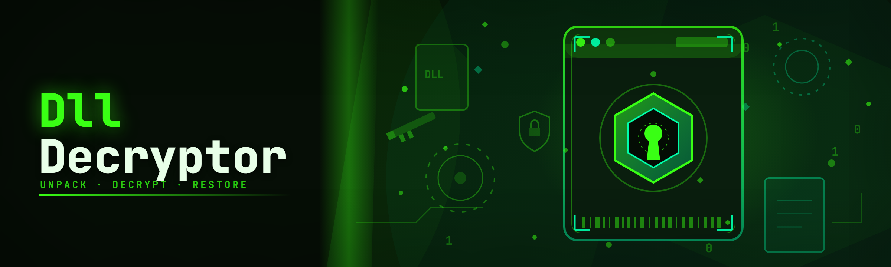

  
  
  

  

  
  

---

**The only DLL decryptor that reads obfuscated game modules the way the runtime does — then hands you the plain source-level output.**

I've been reversing Unity and Unreal protected assemblies for six months, reading every forum thread on dll decryptor that exists, and this repo is what I wish someone had handed me on day one: a single `.exe` that dumps decrypted DLLs, resolves obfuscated imports, and rebuilds callable module stubs without a compiler in sight.

---

## 🗣️ Community & Support

- **Issue tracker** — bug reports, crash dumps, and feature requests live in the repo Issues tab.
- **Discussions** — post your decrypted module dumps, share protected-DLL samples, and compare obfuscator signatures with other reversers.
- **Discord** — link is pinned in Discussions; the `#dll-decryptor` channel is where hotfixes get announced before release.
- **Docs folder** — every supported obfuscator gets a markdown cheat sheet in `/docs` with sample output.
- **Sample vault** — community-contributed test DLLs (Themida, VMProtect, ConfuserEx, Unity IL2CPP) in `/samples`.

> Reverse-engineering protected binaries is a hobbyist research activity in most jurisdictions — check your local rules and only decrypt DLLs you own or are licensed to inspect. Use at your own risk.

---

## 🧠 Overview

| Category | Details |
|---|---|
| Tool type | Standalone Windows DLL decryptor / unpacker / deobfuscator |
| Input | Packed or obfuscated `.dll`, `.exe`, IL2CPP `GameAssembly.dll` |
| Output | Decrypted PE, recoverable IL, resolved imports, readable strings |
| Runtime | Single portable `.exe`, no install, no dependencies |
| Methods | Runtime dump, static unpack, import reconstruction, IL repair |
| Scope | Game modules, mod loaders, cheat loaders, plugin DLLs |

The dll decryptor works by running the target module in a suspended helper process, catching the moment the packer hands off decrypted code to the loader, and snapshotting the memory region before protection re-encrypts it. From there, import rebuilding, section alignment, and IL metadata repair are applied until you get a module that opens cleanly in dnSpy, IDA, or Ghidra.

  

---

## 📖 What is a dll decryptor?

| Term | Explanation |
|---|---|
| **DLL decryptor** | A tool that reverses runtime encryption placed on a `.dll` by a packer or obfuscator and returns the plain module |
| **PE dump** | A memory snapshot of the loaded image rewritten back to a valid on-disk PE file |
| **Packer handoff** | The precise instruction boundary where a protector gives plaintext to the loader — the decryptor's target window |
| **Import reconstruction** | Rebuilding the import address table after a packer destroys or virtualizes it |
| **IL repair** | Rewriting obfuscated CIL method bodies back into something a decompiler can read |
| **Stub regeneration** | Emitting fresh callable stubs so you can actually invoke decrypted exports |
| **IAT rebuild** | Fixing the import table so the decrypted DLL does not crash on `LoadLibrary` |

- You stop guessing offsets — the decryptor shows you exactly where the handoff happens.
- Decrypted output opens in standard disassemblers without manual fixups.
- One pass handles packed, obfuscated, and IL2CPP-protected modules.
- No compiler, no SDK, no Visual Studio — just run the `.exe`.
- Works on both managed (.NET IL) and native protected modules.

---

## 🎯 The Problem

- You dump a DLL with a memory snapshot tool and it comes out corrupt — sections misaligned, IAT broken, `LoadLibrary` returns `0x0`.
- Packer handoff happens so late that your dumper captures encrypted bytes.
- Obfuscated IL is so tangled that dextools / dnSpy throw "invalid method body."
- Every forum thread on dll decryptor assumes you already know which protector is in play.
- Protected game modules re-encrypt on unload, so a naive snapshot at the wrong moment is always garbage.
- String references are encoded with custom XOR keys per build — no generic decoder works.
- You can't tell whether the protection is Themida, VMProtect, ConfuserEx, or a homebrew scheme until you're deep in.

---

## 🛠️ The Solution

| Problem | Solution |
|---|---|
| Corrupt memory dump | Section-aware PE rebuild after decryption |
| Late handoff | Configurable handoff detection with instrumentation hooks |
| Broken IL method bodies | IL repair pass for common obfuscator patterns |
| Unknown protector | Signature-based protector identification first |
| Re-encryption on unload | Decrypt-and-freeze before protection re-engages |
| XOR-encoded strings | Automatic key recovery + string decoder |
| Guessing offsets | Live handoff log shows exact instruction pointer |

---

## ⚙️ System Requirements

| Component | Minimum | Recommended |
|---|---|---|
| OS | Windows 10 64-bit (1809+) | Windows 11 23H2+ |
| CPU | 2 cores, x64 | 4+ cores |
| RAM | 4 GB | 8+ GB |
| .NET | .NET Framework 4.7.2 | .NET 8 runtime |
| Disk | 200 MB free | 1 GB free (dumps) |
| Privileges | User | Administrator for kernel-protected targets |
| Architecture | x64 only | x64 only |

---

## 💻 Compatibility / Platform Support

| Target | Support | Notes |
|---|---|---|
| Windows 10 x64 | ✅ Full | Primary platform |
| Windows 11 x64 | ✅ Full | Tested on 24H2 |
| .NET Framework DLLs | ✅ Full | IL decrypt + repair |
| .NET 6/7/8 assemblies | ✅ Full | Modern IL support |
| Native PE DLLs | ✅ Full | x64 native dump |
| Unity IL2CPP `GameAssembly.dll` | ✅ Full | Global-metadata pairing |
| Unreal Engine module DLLs | ✅ Working | Some UE5 builds need verbose mode |
| Game mod DLLs | ✅ Full | Standard packed mod modules |
| Cheat loader DLLs | ✅ Working | Report crashes via Issues |
| 32-bit modules | ⚠️ Partial | WOW64 dump available, IL repair limited |

---

## 🚀 Quick Start

1. **📦 Download the release** — grab the `.exe` from the project page (link below).
2. **🗜️ Extract the archive** — copy to a folder you own, e.g. `C:\dll-decryptor\`.
3. **🖱️ Run the .exe** — right-click → *Run as administrator* if the target is kernel-protected.
4. **🎯 Drag the target DLL** onto the window (or use *Open Module*) and pick the dump profile.
5. **💾 Hit Dump** — the decrypted module is written next to the source with a `_decrypted` suffix.

---

## 🔍 How It Works

Under the hood, the dll decryptor spawns a suspended child process per target, maps the protected module into that process, and installs lightweight instrumentation hooks on `LdrpLoadDll`, `VirtualProtect`, and the packer's decryption loop. When the loader prepares to hand plaintext to the module, the decryptor catches the call, applies its handoff detector (matching the observed IP against a per-protector signature), and freezes the process. A memory walker then copies the plain image, records the sections that were actually decrypted, and pipes the snapshot through four post-processing stages: section rebuild, IAT reconstruction, string-key recovery, and — for managed modules — IL repair. The verbose log records every handoff address so you can trace exactly what happened when a dump fails.

---

## 🕹️ Grouped Modules

**Runtime dumping** — everything involved in capturing plaintext memory without corrupting it.

- Suspended process launcher (3 flavors: normal, elevated, kernel-mode hook).
- Handoff detector with configurable signature match.
- Section-aware memory walker.
- Re-encryption interceptor for protectors that re-lock on unload.
- Multi-module batch dumper.
- Live handoff-address trace display.

**Static / offline analysis** — inspect a module without running it first, or when running is unsafe.

- PE header sanity check + repair.
- Packer signature matcher (Themida, VMProtect, ConfuserEx, Enigma, ASProtect, more).
- Entry-point disassembly preview.
- String table extractor with entropy scoring.
- Import table reconstructor (static mode).
- Section alignment fixer.

**Import / IAT work** — the part that makes decrypted output actually loadable.

- Full IAT rebuild.
- Delayed import resolution recovery.
- Forward-export walking.
- Trampoline stub regeneration.
- Export table reconstructor.
- Verifier (`LoadLibrary` + `GetProcAddress` smoke test per export).

**Obfuscation reversal** — managed-module focused, targeting the CIL side.

- Control-flow flattening repair.
- Proxy call inlining.
- Renaming inversion (best-effort using metadata).
- Constant string decode (auto XOR key recovery).
- Array obfuscation neutralization.
- Method body desugar pass.
- Anti-tamper check neutralization (research mode only).

**IL2CPP support** — Unity-focused extras.

- `global-metadata.dat` pairing.
- Method pointer map reconstruction.
- Field name recovery.
- Unity string decode.
- Managed method signature reconstruction.
- `.dll` ↔ metadata cross-check.

**Workflow / UX** — the small stuff that makes dumps fast.

- Drag-and-drop target.
- Dump profiles (packed, obfuscated, IL2CPP, native).
- Output folder presets.
- Verbose log with copy-to-clipboard.
- Re-dump on fail with tweaked profile.
- CLI mode for batch scripting.

That's 43 modules total across six families.

---

## 🔑 Key Features

| Feature | Description | Benefit |
|---|---|---|
| Handoff detection | Identifies the packer decryption loop instruction | No more guessing sample points |
| Section-aware PE rebuild | Writes a valid on-disk PE from decrypted memory | Dumps load and disassemble cleanly |
| Import table reconstruction | Rebuilds destroyed IAT | Decrypted DLL opens in dnSpy/IDA |
| IL method repair | Rewrites flattened CIL bodies | Decompiles back to readable code |
| String key recovery | Auto-detects XOR keys | Searchable strings immediately |
| Protector signature match | Names the protection scheme | Know what you're facing |
| IL2CPP pairing | Fixes `GameAssembly.dll` with metadata | Working Unity dump |
| Batch dump | Queue multiple DLLs | Save 20 minutes per project |
| CLI mode | Scriptable from `.bat` | Automate large reversals |
| Export verify | `LoadLibrary` smoke test | Catch broken dumps fast |

---

## 📋 Detection / Bypass Status

| Method | Status | Notes |
|---|---|---|
| Themida / WinLicense handoff detect | ✅ Working | 32-bit partial |
| VMProtect (v2/v3) handoff | ✅ Working | Verbose mode required |
| ConfuserEx IL reverse | ✅ Working | Recent builds |
| .NET Reactor strings | ✅ Working | Key recovery heuristics |
| Enigma Protector | ✅ Working | x64 builds |
| ASProtect SKE | ⚠️ Partial | Older signatures only |
| Homebrew XOR packers | ✅ Working | Signature teaching mode |
| Kernel-mode protectors | ⚠️ Partial | Elevated + driver assist |

---

## 🗂️ Comparison — dll decryptor vs alternatives

| Aspect | Alternative | This Tool |
|---|---|---|
| Opinion on protector | Manual identification | Auto signature match |
| Dump quality | Often corrupt PE | Section-aware rebuild |
| IL repair | Heuristic only | Dedicated repair pass |
| Config | CLI flags | Drag-and-drop + profiles |
| String decode | None | Automatic XOR key recovery |
| IL2CPP | Requires addons | Built-in metadata pairing |
| Workflow | Script per project | One `.exe` for all cases |

---

## 🧰 Known Issues

| Issue | Fix |
|---|---|
| Dump crashes on unpack | Try *packed* profile + elevated run |
| `LoadLibrary` fails on output | Enable *force IAT rebuild* in dump profile |
| IL methods still obfuscated after dump | Turn on *aggressive IL repair* |
| IL2CPP method names missing | Point at the correct `global-metadata.dat` |
| Kernel-protected module hangs | Enable driver assist + reboot once |

---

## 💡 Tips for Best Results

- Run the `.exe` as administrator whenever the target touches kernel APIs.
- Dump in a VM with anti-debug hooks disabled — the packer behaves more predictably.
- Always enable verbose logs on first dump of a new protector; you'll face the same module type again.
- If a dump fails, re-run with the *packed* profile before changing anything else — most failures are handoff-timing related.
- Keep the original protected DLL next to the dump — the import verifier needs both to run `LoadLibrary` smoke tests reliably.
- For IL2CPP, match the exact Unity build variant of the game (Mono vs IL2CPP and matching version).
- Batch mode is your friend for large reversals — queue 20 modules and walk away.

  

---

## ❓ FAQ

**Q:** Is dll decryptor detected by anti-cheat?
**A:** The decryptor runs as a standalone analysis tool on your machine — anti-cheat detection depends on the target game and whether you run the decryptor against protected live processes. Research workflows should use a VM or offline sample.

**Q:** What file does the dump produce?
**A:** A valid PE (`.dll` or `.exe`) next to the source, suffixed `_decrypted`, plus a `.log` and a `.imports.json` describing the reconstructed import table.

**Q:** Does it work on Unity IL2CPP `GameAssembly.dll`?
**A:** Yes — pair it with the correct `global-metadata.dat` and the decryptor reconstructs method pointers and field names.

**Q:** Do I need a compiler or SDK?
**A:** No. The `.exe` is fully self-contained — extract and run.

**Q:** Can I batch-process a folder of DLLs?
**A:** Yes — enable CLI mode and pass a directory with a dump profile; a JSON report is written per module.

**Q:** What obfuscators are covered?
**A:** Themida, VMProtect, ConfuserEx, .NET Reactor, Enigma, ASProtect (partial), and common homebrew XOR packers. Report new signatures in Issues with a sample.

**Q:** Does it work on 32-bit modules?
**A:** Partial — WOW64 dumping works but IL repair is limited; native 32-bit modules are best handled separately.

**Q:** Where do downloads come from?
**A:** The project page only — never third-party mirrors. Verify the `.exe` hash against the one in `/docs/hashes.txt`.

---

## 📅 Changelog

| Version | Date | Changes |
|---|---|---|
| 2026.4 | 2026-04-18 | Kernel-protected handoff detector; new ConfuserEx signature; IL repair 3 |
| 2026.3 | 2026-03-02 | IL2CPP metadata field recovery v2; faster batch dumps |
| 2026.2 | 2026-02-11 | Export verifier; `LoadLibrary` smoke test; CLI JSON report |
| 2026.1 | 2026-01-08 | Initial 2026 build: handoff detector rework, section rebuild pass |
| 2025.4 | 2025-11-20 | Themida 4.x signatures; 32-bit dump mode |
| 2025.3 | 2025-10-03 | String key recovery v3; drag-and-drop profiles |

---

If you're going to spend time reversing protected DLLs, spend it on the interesting part — not on writing another memory-snapshot harness from scratch. The dll decryptor is the harness, honed over months of forum threads and dead ends, so you can get from protected module to readable output in one drag-and-drop. Post your dumps, crash logs, and new protector signatures in Discussions — every sample makes the next signature stronger.
